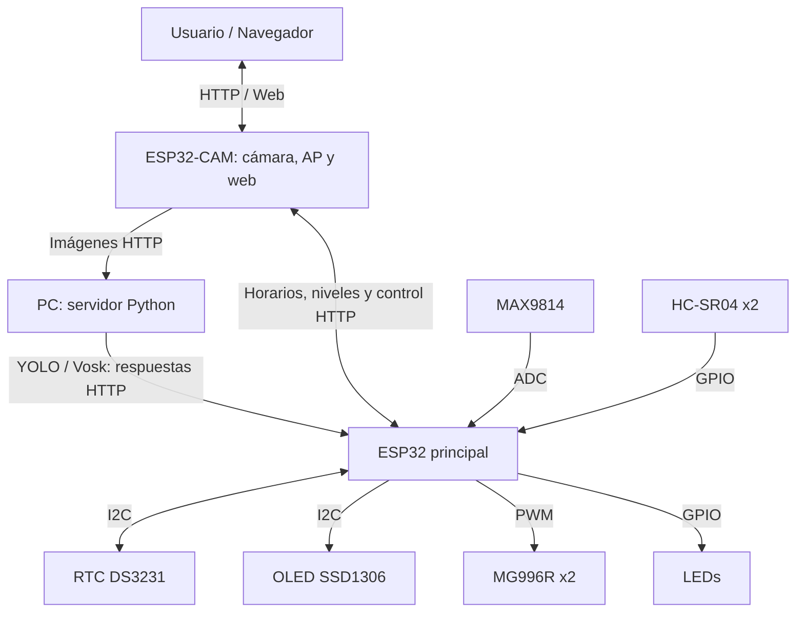
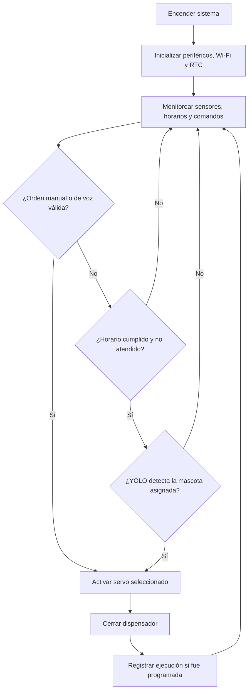

# Comedero Inteligente para Mascotas basado en IoT

> Prototipo académico de alimentación automatizada para dos mascotas mediante ESP32, ESP32-CAM, reconocimiento visual YOLO, reconocimiento de voz Vosk y control web.

## 1. Descripción

Este proyecto busca facilitar la alimentación programada de dos mascotas mediante un sistema embebido conectado por Wi-Fi. Permite configurar horarios, visualizar una cámara en vivo, controlar manualmente dos dispensadores y supervisar el nivel estimado de alimento. En el prototipo, el reconocimiento visual se prueba con **dos peluches**, no con mascotas reales.

El sistema utiliza un **ESP32 principal** para sensores, RTC, OLED, indicadores y servomotores; una **ESP32-CAM** para la cámara, punto de acceso e interfaz web; y una **computadora con Python** para ejecutar YOLO y Vosk.

## 2. Funcionalidades

- Programación de horarios independientes para los comederos 1 y 2 desde la página web.
- Dispensación automática condicionada al horario y a la detección visual de la mascota correspondiente.
- Control manual de cada dispensador desde el navegador.
- Reconocimiento de voz con palabra de activación y comandos específicos.
- Video en vivo y visualización de las detecciones YOLO.
- Estimación del nivel de alimento mediante sensores ultrasónicos HC-SR04.
- Visualización local mediante pantalla OLED SSD1306 e indicadores LED.
- Sincronización de hora mediante RTC DS3231.
- Punto de acceso Wi-Fi de la ESP32-CAM, con opción de conexión a redes externas.

## 3. Componentes principales

| Componente | Cantidad | Función |
|---|---:|---|
| ESP32 convencional | 1 | Control de sensores, RTC, servomotores, OLED y LEDs |
| ESP32-CAM con OV2640 | 1 | Captura de imágenes, transmisión de video e interfaz web |
| Servomotor MG996R | 2 | Accionamiento de los dispensadores |
| Sensor HC-SR04 | 2 | Estimación de nivel de alimento |
| RTC DS3231 | 1 | Fecha y hora para la programación |
| Pantalla OLED SSD1306 | 1 | Información local del sistema |
| Micrófono MAX9814 | 1 | Captura de audio para reconocimiento de voz |
| LEDs | 3 | Indicadores de conexión, dispensación y nivel bajo |
| Computadora con Python | 1 | Servidor Flask, YOLO y Vosk |
| Fuente de alimentación y regulador | Según montaje | Alimentación estable del circuito y servos |

> **Seguridad eléctrica:** los servomotores requieren una alimentación adecuada y una referencia de tierra común con el ESP32. No se deben alimentar directamente desde un GPIO.

## 4. Arquitectura del sistema



### Responsabilidades

**ESP32-CAM:** publica la interfaz web, gestiona los horarios, transmite imágenes y ofrece conectividad Wi-Fi.

**ESP32 principal:** consulta los horarios y las detecciones, obtiene la hora del RTC, lee los sensores y activa el servo correspondiente.

**Servidor Python:** recibe imágenes de la ESP32-CAM para detección YOLO y procesa audio mediante Vosk. Debe permanecer ejecutándose para que funcionen las características que dependen de él.

## 5. Requisitos de software

- Arduino IDE o PlatformIO con soporte para ESP32.
- Python 3 compatible con las dependencias del servidor.
- Modelo YOLO entrenado (`best.pt`) para las clases `peluche_1` y `peluche_2`.
- Modelo de idioma de Vosk en la carpeta `modelo`.
- Bibliotecas Python utilizadas por el servidor: Flask, Flask-CORS, Ultralytics, OpenCV, NumPy, Requests, Vosk y SoundDevice (según la versión del script).
- Bibliotecas Arduino requeridas por los sketches, como `WiFi`, `HTTPClient`, `Wire`, `ESP32Servo`, `RTClib`, `Adafruit_GFX`, `Adafruit_SSD1306` y las dependencias específicas del proyecto.

> Los nombres de los scripts y las versiones exactas de bibliotecas deben verificarse en los archivos definitivos del repositorio.

## 6. Organización sugerida del repositorio

```text
Comedero-Inteligente/
├── README.md
├── esp32-principal/
│   └── esp32-principal.ino
├── esp32-cam/
│   └── esp32-cam.ino
├── servidor-python/
│   ├── servidor.py
│   ├── best.pt
│   ├── modelo/                 # Modelo Vosk (no incluido necesariamente)
│   └── requirements.txt
└── docs/
    ├── diagramas/
    └── evidencias/
```

Esta estructura es **una propuesta**: adapta los nombres a tus archivos reales. No subas el entorno virtual `venv/` a GitHub. Comprueba también el tamaño y los derechos de distribución de los modelos antes de publicarlos.

## 7. Instalación del servidor Python (Windows)

1. Abre una terminal dentro de la carpeta del servidor.
2. Crea el entorno virtual:

   ```powershell
   py -m venv venv
   ```

3. Actívalo en PowerShell:

   ```powershell
   .\venv\Scripts\Activate.ps1
   ```

4. Instala las dependencias:

   ```powershell
   python -m pip install --upgrade pip
   pip install flask flask-cors ultralytics opencv-python numpy requests vosk sounddevice
   ```

5. Coloca el archivo `best.pt` y la carpeta `modelo` donde los espere tu script.
6. Ejecuta el servidor con el **nombre real de tu archivo**:

   ```powershell
   python servidor.py
   ```

7. Verifica que la computadora y los ESP32 estén conectados a la red configurada para el proyecto.

### Direcciones IP utilizadas en el prototipo

| Equipo | Dirección de referencia |
|---|---|
| ESP32-CAM, punto de acceso | `192.168.4.1` |
| ESP32 principal | `192.168.4.2` |
| Computadora con servidor Python | `192.168.4.3:5000` |

**Importante:** estas direcciones corresponden a la configuración utilizada en el prototipo. Si cambia la red o la IP de la computadora, ajusta las direcciones definidas en los programas. Para acceder desde una red doméstica, utiliza la IP que obtenga la ESP32-CAM en esa red.

## 8. Configuración de los microcontroladores

### ESP32-CAM

1. Abre el sketch correspondiente en Arduino IDE o PlatformIO.
2. Selecciona la placa y el puerto serie adecuados.
3. Comprueba los parámetros de cámara, punto de acceso y redes Wi-Fi.
4. Carga el firmware y abre el monitor serie para verificar el arranque.
5. Conéctate al punto de acceso `Comedero_ESP32` y abre `http://192.168.4.1`.

La configuración conocida del punto de acceso del prototipo es:

- **SSID:** `Comedero_ESP32`
- **Contraseña de desarrollo:** `Comedero123`

**Cambia esta contraseña antes de usar el equipo fuera de un entorno de pruebas.** El proyecto contempla guardar configuraciones de redes Wi-Fi en EEPROM.

### ESP32 principal

1. Abre el sketch del ESP32 principal.
2. Revisa los pines, direcciones IP y bibliotecas requeridas.
3. Conecta sensores, RTC, OLED, LEDs, micrófono y servomotores de acuerdo con el montaje validado.
4. Carga el firmware y comprueba los mensajes del monitor serie.
5. Verifica que el dispositivo pueda consultar horarios y detecciones del servidor.

### Pines de referencia del ESP32 principal

| Función | GPIO |
|---|---:|
| Servo 1 | 13 |
| Servo 2 | 14 |
| HC-SR04 1: TRIG / ECHO | 25 / 34 |
| HC-SR04 2: TRIG / ECHO | 26 / 35 |
| MAX9814 (ADC) | 36 |
| I2C: SDA / SCL | 21 / 22 |
| LED verde | 18 |
| LED amarillo | 19 |
| LED rojo | 23 |

Los pines deben coincidir con el código final. Protege las entradas ECHO de 5 V de los sensores ultrasónicos mediante adaptación de nivel a 3,3 V.

## 9. Manual de uso

### 9.1 Encendido

1. Alimenta correctamente los ESP32 y los servomotores.
2. Conecta la computadora a la red del proyecto e inicia el servidor Python.
3. Comprueba la conectividad entre el ESP32 principal, la ESP32-CAM y el servidor.
4. Abre la interfaz web de la ESP32-CAM desde un navegador.

### 9.2 Configurar horarios

1. Ingresa a la sección **Horarios de alimentación**.
2. Selecciona el comedero o mascota correspondiente.
3. Establece la hora y pulsa **Agregar horario**.
4. Confirma que aparezca en la lista de horarios.
5. Para eliminarlo, utiliza el botón **Eliminar** de la entrada correspondiente.

**Condición de alimentación automática:** el horario debe haberse cumplido, el servidor YOLO debe responder con una detección válida de la mascota configurada y ese horario no debe haberse ejecutado ya durante el día. Si la mascota no está presente, el sistema continúa esperando durante ese día.

### 9.3 Alimentación manual

Desde la página web, pulsa **Alimentar mascota 1** o **Alimentar mascota 2**. El ESP32 principal acciona el servomotor correspondiente, espera el tiempo configurado y vuelve a la posición cerrada. Este modo no necesita una detección YOLO.

### 9.4 Comandos de voz

1. Pronuncia **«Arcana»** para activar el reconocimiento de órdenes.
2. Pronuncia uno de los siguientes comandos:

   - **«Fénix ábrete»**: activa el comedero 1.
   - **«Dragón ábrete»**: activa el comedero 2.

3. Si no se reconoce una orden válida, el sistema vuelve a esperar la palabra de activación.

La captura se realiza con MAX9814 y el reconocimiento con Vosk en la computadora.

### 9.5 Visualización y niveles

- En la página web se muestra el video de la ESP32-CAM y el estado reportado por el sistema.
- La pantalla OLED muestra información local del dispositivo.
- Los sensores ultrasónicos estiman el nivel de alimento; **no miden el peso ni garantizan una porción exacta**.

### 9.6 Indicadores LED

| Indicador | Significado previsto |
|---|---|
| Verde | Conectividad Wi-Fi del ESP32 principal |
| Amarillo | Dispensación en curso |
| Rojo fijo | Nivel del depósito 1 entre 0 % y 20 % |
| Rojo intermitente | Lectura no válida del sensor 1 |

Los indicadores deben contrastarse con el firmware cargado; la integración física final puede variar.

## 10. Flujo de funcionamiento



## 11. Pruebas y validación

| Prueba | Procedimiento | Resultado esperado |
|---|---|---|
| Wi-Fi | Conectar ESP32-CAM, ESP32 principal y PC | Comunicación entre equipos |
| Horarios | Crear y borrar horarios desde la web | Cambios reflejados en el ESP32 |
| YOLO | Mostrar peluche 1 y peluche 2 ante la cámara | Detección de la clase correspondiente |
| Automática | Cumplir horario con mascota detectada | Se acciona una sola vez el comedero asignado |
| Mascota ausente | Cumplir horario sin detección válida | No se dispensa automáticamente |
| Voz | Decir «Arcana» y una orden | Se activa el servo indicado |
| Manual | Pulsar un botón de alimentación | Se abre y cierra el servo seleccionado |
| Nivel | Variar distancia del HC-SR04 | Cambia el porcentaje estimado |
| Indicadores | Simular nivel bajo o lectura inválida | Señal LED correspondiente |
| Fallo de servidor | Detener Python temporalmente | Se bloquea la alimentación automática dependiente de YOLO |

Esta tabla define **criterios de prueba**, no afirma que todas las pruebas se hayan superado.

## 12. Limitaciones y mejoras futuras

- **Reconocimiento visual:** el modelo actual fue preparado para distinguir dos peluches; requiere nuevas capturas, entrenamiento y validación antes de usarse con mascotas reales.
- **Servidor local:** YOLO y Vosk dependen de una computadora encendida y conectada a la red.
- **Conectividad:** las funciones distribuidas pueden verse afectadas por desconexiones Wi-Fi.
- **Dosificación:** el servo controla una compuerta, pero no hay una celda de carga que confirme la cantidad exacta dispensada.
- **Mecanismo de dispensación:** se evalúa reemplazar la apertura directa por un **tornillo sin fin con motorreductor**, para reducir el riesgo de atascos o fallas por el peso del alimento.
- **Sensor 2:** se ha observado una falla de lectura; las alertas de nivel se basan actualmente en el sensor 1.
- **Energía:** se contempla estudiar una alimentación por baterías para evitar cables expuestos que puedan morder las mascotas. Deben evaluarse autonomía, corriente de arranque y protección eléctrica.
- **Seguridad:** se recomienda cambiar credenciales predeterminadas, proteger la interfaz web y evitar exponer el dispositivo directamente a internet.

## 13. Consideraciones de seguridad y bienestar animal

Este prototipo es de carácter académico y **no sustituye la supervisión de una persona responsable**. Antes de emplearlo con animales reales se deben validar las porciones, la resistencia mecánica, la ausencia de puntos de atrapamiento, el comportamiento ante fallas eléctricas y la privacidad de la cámara. La dispensación automática debe probarse exhaustivamente antes de dejar el equipo funcionando sin vigilancia.

## 14. Autores

- **Cristhian Ortiz Aldean**
- **Axel Sánchez Pincay**

Proyecto académico: *Sistema inteligente de alimentación automática para mascotas basado en IoT*.

---
